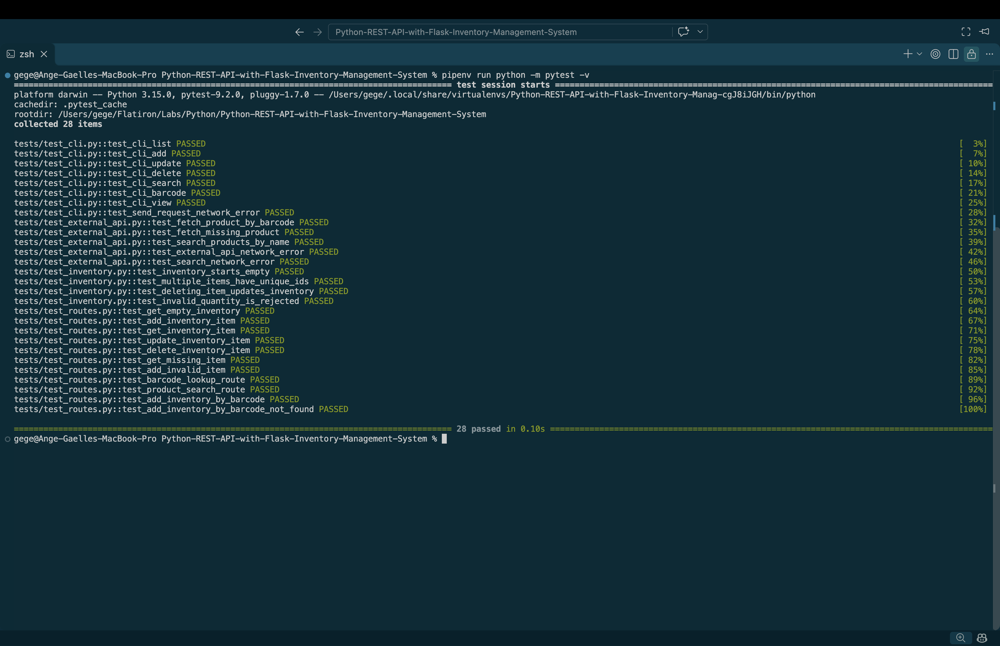

# Python REST API with Flask — Inventory Management System

## Project Overview

This project is an Inventory Management System built with Python and Flask.

It provides a RESTful API for managing inventory items, including creating, viewing, updating, and deleting products.

The application also integrates with the OpenFoodFacts API to retrieve product information using barcodes or product names.

A command-line interface (CLI) allows users to interact with the inventory system directly from the terminal.

## Technologies Used

- Python
- Flask
- Requests
- Pytest
- Pipenv
- OpenFoodFacts API
- argparse

## Features

- View all inventory items
- View an individual inventory item
- Add new inventory items
- Update existing inventory items
- Delete inventory items
- Validate inventory data
- Search OpenFoodFacts by product name
- Retrieve product information by barcode
- Add inventory items using OpenFoodFacts data
- Manage inventory through a CLI
- Automated testing with pytest

## Project Structure

```text
Python-REST-API-with-Flask-Inventory-Management-System/
├── app/
│   ├── __init__.py
│   ├── routes.py
│   ├── inventory.py
│   └── external_api.py
├── cli/
│   ├── __init__.py
│   └── commands.py
├── tests/
│   ├── __init__.py
│   ├── test_routes.py
│   ├── test_inventory.py
│   ├── test_external_api.py
│   └── test_cli.py
├── app.py
├── Pipfile
├── Pipfile.lock
├── .gitignore
└── README.md
```

## Installation and Setup

### 1. Clone the repository

```bash
git clone git@github.com:a-gbatie/Python-REST-API-with-Flask-Inventory-Management-System.git
```

### 2. Navigate to the project directory

```bash
cd Python-REST-API-with-Flask-Inventory-Management-System
```

### 3. Install dependencies

Make sure Python and Pipenv are installed.

```bash
pipenv install
```

### 4. Start the Flask server

```bash
pipenv run python app.py
```

The API runs at:

```text
http://127.0.0.1:5000
```

## API Endpoints

| Method | Endpoint | Description |
|--------|----------|-------------|
| GET | `/inventory` | Retrieve all inventory items |
| GET | `/inventory/<id>` | Retrieve an item by ID |
| POST | `/inventory` | Create an inventory item |
| PATCH | `/inventory/<id>` | Update an inventory item |
| DELETE | `/inventory/<id>` | Delete an inventory item |
| GET | `/products/barcode/<barcode>` | Look up a product by barcode |
| GET | `/products/search?name=<name>` | Search OpenFoodFacts by name |
| POST | `/inventory/barcode` | Add an inventory item using a barcode |

## API Usage Examples

### Get all inventory items

```bash
curl http://127.0.0.1:5000/inventory
```

### Add an inventory item

```bash
curl -X POST http://127.0.0.1:5000/inventory \
  -H "Content-Type: application/json" \
  -d '{"name":"Milk","quantity":5,"price":3.99}'
```

### Get an inventory item

```bash
curl http://127.0.0.1:5000/inventory/1
```

### Update an inventory item

```bash
curl -X PATCH http://127.0.0.1:5000/inventory/1 \
  -H "Content-Type: application/json" \
  -d '{"quantity":10}'
```

### Delete an inventory item

```bash
curl -X DELETE http://127.0.0.1:5000/inventory/1
```

### Search OpenFoodFacts by product name

```bash
curl "http://127.0.0.1:5000/products/search?name=Nutella"
```

### Look up a product by barcode

```bash
curl http://127.0.0.1:5000/products/barcode/3017620422003
```

### Add an inventory item using a barcode

```bash
curl -X POST http://127.0.0.1:5000/inventory/barcode \
  -H "Content-Type: application/json" \
  -d '{"barcode":"3017620422003","quantity":10,"price":5.99}'
```

## Command-Line Interface (CLI)

The application includes a CLI built using Python's `argparse` module.

The Flask server must be running before executing CLI commands.

### List all inventory items

```bash
pipenv run python -m cli.commands list
```

### View an inventory item

```bash
pipenv run python -m cli.commands view 1
```

### Add an inventory item

```bash
pipenv run python -m cli.commands add "Milk" 5 3.99
```

### Update an inventory item

```bash
pipenv run python -m cli.commands update 1 --quantity 8
```

### Delete an inventory item

```bash
pipenv run python -m cli.commands delete 1
```

### Search OpenFoodFacts

```bash
pipenv run python -m cli.commands search "Nutella"
```

### Add a product using its barcode

```bash
pipenv run python -m cli.commands barcode 3017620422003 10 5.99
```

## OpenFoodFacts API Integration

The application integrates with the OpenFoodFacts API to retrieve product information.

Users can search for products by name or retrieve product details using a barcode.

Retrieved information may include:

- Product name
- Barcode
- Brand
- Ingredients

The barcode inventory endpoint automatically adds retrieved product information to the inventory along with the supplied quantity and price.

External API requests include a timeout and basic error handling.

## Data Storage

The application uses an in-memory Python list as a mock database.

Each inventory item contains:

- A unique ID
- Product name
- Quantity
- Price

Items imported from OpenFoodFacts may also contain a barcode, brand, and ingredients.

Because the data is stored in memory, inventory items are reset when the Flask server restarts.

## Testing

The application uses pytest to test inventory operations, Flask routes, external API integration, and CLI commands.

External API requests are mocked during automated testing to avoid relying on live network responses.

Run all tests with:

```bash
pipenv run python -m pytest -v
```

The test suite contains 28 tests covering:

- CRUD endpoints
- Input validation
- Inventory data behavior
- OpenFoodFacts API functions
- Flask integration with OpenFoodFacts
- CLI commands
- Network error handling

**Test Results: 28 passed**

## Screenshot of Completed Tests

